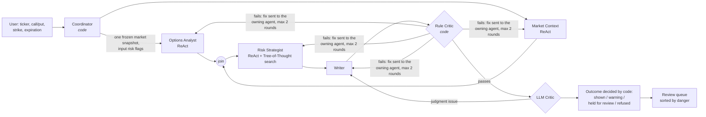

# AI Options Trade Analyzer

A multi-agent AI system that explains one proposed options trade (ticker, call or put, strike, expiration) to
a beginner: what it costs, the most it can lose, where it breaks even, how time and volatility work against
it, what could move the stock before expiry, and a lower-risk alternative with its trade-offs stated. Every
number comes from deterministic Python tools; the language models only interpret them, and layered checks
hold any report they cannot clear for a person to review.

**Education only.** The system has no order, account or payment tool. It never places, prepares or simulates
a trade, and its reports never recommend buying, selling or a position size.

Capstone project for the Agentic AI program (Carnegie Mellon University School of Computer Science, Executive
Education), by Sridhar Katikala. The full design, decision history and every evaluation result are in
[docs/DESIGN.md](docs/DESIGN.md).

**Video presentation:** [vimeo.com/1248877894](https://vimeo.com/1248877894) (architecture, evaluation results
and a live demo).

## The problem

New options traders often lose money even when they are right about the stock's direction: implied volatility
collapses after earnings, time decay eats a short-dated option, a wide bid-ask spread costs more than the move
earns. The numbers that reveal these risks (Greeks, breakeven, liquidity, the earnings date) are scattered
across several screens and are hard to read without experience.

**Intended user:** a self-directed retail investor or finance student who understands stocks but is new to
options and wants to understand a trade before deciding anything.

## What a report looks like

[docs/examples/wmt_127_call_report.md](docs/examples/wmt_127_call_report.md) is a complete report produced
by the team on Claude Haiku. An excerpt:

> The option costs 4.40 per share ($440 per contract) and has 7 days to expiry. Its maximum loss is the full
> $440 premium, and it breaks even at 131.40, about 3.08% above the stock price of 127.47. Earnings are due on
> 2026-11-19, one day before expiration, so the release falls inside the option's life.

Each report has the same sections: Summary, Key numbers, Data quality, Main risks, Lower-risk alternative,
What to watch, Limits of this analysis.

## Architecture



| Component | What it does | Code |
| --- | --- | --- |
| Coordinator (code) | Validates the contract, loads one market snapshot for every agent, computes input risk flags, routes fixes, enforces round limits | `agents/team.py` |
| Options Analyst | Price vs model, Greeks, liquidity, quote freshness, implied volatility | `agents/team.py`, `agents/tools.py` |
| Market Context | Price trend, earnings date, recent headlines (screened for prompt injection) | `agents/tools.py`, `data/news.py`, `injection.py` |
| Risk Strategist | Maximum loss, breakeven, volatility-drop scenario, lower-risk alternative | `agents/tot_search.py`, `analytics/alternatives.py` |
| Writer | One report built only from the three agents' findings | `agents/team.py` |
| Rule Critic | Every number, date and citation must match a tool output; no advice; no overconfident wording; required warnings and trade-offs present | `agents/verifier.py` |
| LLM Critic | 7-point judgment checklist the rules cannot check; names the agent that must fix each problem | `agents/critic.py` |
| Tree-of-Thought search | Beam search (width 3, depth 3) over strategy family, strikes and expiration, scored out of 100 by code, with objective pruning | `agents/tot_search.py` |
| Retrieval (RAG) | 18 options-education notes and recent headlines, with a similarity floor and MMR for diversity | `retrieval/` |
| Math | Black-Scholes price and Greeks, payoff, multi-leg strategies, data quality, risk-adjusted measures | `analytics/` |
| Outcomes and review | Code decides the outcome; held runs wait in a review queue sorted by danger; every run and decision is logged | `review.py`, `app.py` |

Agents share one typed LangGraph state. Each specialist runs a ReAct loop (reason, call a tool, observe, repeat)
and returns short findings, each tagged with the tool it came from.

## Safety and human oversight

- **Before generation:** the contract must exist; code flags risky contracts (2 days or fewer, poor liquidity,
  a closed-market quote, under 15% chance beyond breakeven, missing data) and shows the flags above the report.
- **During generation:** read-only tools only, one frozen data snapshot, limits on tool rounds, revisions and
  reply length; a failed data source returns an error instead of crashing; headlines that read like
  instructions to an AI are withheld.
- **After generation:** the rule Critic, then the LLM Critic, each sending fixes to the agent that owns them.
- **Human review:** a report that still fails, a failed agent or data source, missing data or a withheld
  headline is held. The review queue puts the most dangerous problems first (a made-up maximum loss before a
  missing implied volatility); the reviewer approves, edits or rejects, and the decision is appended to an audit
  log.

## Evaluation results

All runs replay recorded market data, so every setup sees identical inputs and results are repeatable.
Answer keys built from the same data list what each report must and must not say.

**Acceptance gate on Claude Haiku** (22 contracts: 10 core plus 12 scenarios covering earnings before expiry,
same-day expiry, very low chance, deep in the money, long-dated and delayed quotes):

| Measure | Target | Claude Haiku | qwen3:8b (local) |
| --- | --- | --- | --- |
| Numbers, dates, citations no tool returned | 0 | 0 | 0-4 |
| Reports giving advice | 0 | 0 | 0 |
| Required facts stated | 90% or more | 98-100% | 77-85% |
| Judgment errors per 10 reports (hand-checked) | 1 or fewer | 0 | 1-2 |
| Held for review on normal data | 20% or less | 0% | 10-20% |
| Missing-data runs ending labeled, not crashed | 100% | 18 of 18 | not run |
| Direct prompt injections caught / false alarms | 100% / 0 | 14 of 14 / 0 of 2,092 real headlines | same |
| Time per run | 2 min or less | 28-65 s, about 1 cent | 16-65 min |

Other findings:

- **Rule checks matter most on a weak model.** On qwen3:8b the verifier cut untraced numbers in final reports
  from 24 (first drafts) to 3; retrieval alone made reports *less* accurate while adding citations.
- **Tree-of-Thought beats a fixed spread.** A fixed spread was offered for 22 of 22 contracts and 15 of those
  failed the search's own rules (mostly a poorly traded leg). The ToT search never offered one that fails, and
  said "no qualifying alternative" when none qualified. The LLM proposer outscored the rule proposer in 7 of 11
  contracts and never scored lower.
- **The team vs one agent.** On qwen3:8b the team with the LLM Critic was the most reliable (10 of 10 final
  reports passing); on Haiku one agent did as well, faster (33 s vs 57 s). The team stays for clear ownership
  and routing of fixes.
- **Known limit:** the injection monitor caught only 1 of 6 plain-language attacks it had not seen, so the
  output checks, not the monitor, are the main defense.

Results: [docs/evaluation/](docs/evaluation/) (`summary_*.md` and `quality_*.md` per run,
`tot_summary*.md` for the alternative search, [injection.md](docs/evaluation/injection.md), the
[hand-scoring rubric](docs/evaluation/hand_scoring.md)).

## Setup

Requires [uv](https://docs.astral.sh/uv/) and [Ollama](https://ollama.com) (for the local embedding model,
and optionally the free local LLM).

```bash
git clone https://github.com/sridharkatikala483/options-trade-analyzer.git
cd options-trade-analyzer
uv sync                       # Python 3.12 and every dependency, into .venv
cp .env.example .env          # then edit .env (see below)
ollama pull nomic-embed-text  # embeddings for retrieval, about 270 MB (always needed)
ollama pull qwen3:8b          # only for LLM_PROVIDER=ollama, about 5 GB
```

In `.env`:

- `LLM_PROVIDER=anthropic` with `ANTHROPIC_API_KEY` and `ANTHROPIC_MODEL=claude-haiku-5-5` (about 1 cent and
  under a minute per analysis; needs prepaid API credits), or `LLM_PROVIDER=ollama` (free, 16-65 minutes per
  analysis on a laptop).
- `DATA_PROVIDER=snapshot` (the default in `.env.example`) replays the recorded scenario data with no network
  calls for market data; `DATA_PROVIDER=yfinance` fetches live data from Yahoo Finance.

Check the setup:

```bash
uv run python scripts/check_setup.py
```

## Usage

**Dashboard:**

```bash
uv run streamlit run app.py   # http://localhost:8501
```

Pick a recorded contract in the sidebar to see its numbers, data-quality checks and payoff chart (no LLM
needed), then click **Run AI analysis** to run the agent team with live progress. The tabs show each agent's
findings and tool calls, the Critic's checks on the first draft and the final report, and a timeline. The
**Review queue** page lists held reports, most dangerous first.

**Tests** (offline: no network, no LLM, about 3 seconds):

```bash
uv run pytest
```

**Evaluation** (on recorded data; each run writes results, a summary and a quality report to
`docs/evaluation/`):

```bash
uv run python scripts/evaluate.py --specs scenarios --setups retrieval_verified_tot,multi_agent --out my_run
uv run python scripts/score_reports.py my_run          # answer keys + acceptance gate
uv run python scripts/evaluate_tot.py --specs scenarios --no-llm   # alternative search, no LLM calls
uv run python scripts/injection_eval.py                # injection monitor, seconds
uv run python scripts/record_snapshot.py --specs scenarios   # record new market data (market hours)
```

## Reviewing the project

| To see | Look at |
| --- | --- |
| The design and how it changed after each checkpoint | [docs/DESIGN.md](docs/DESIGN.md) |
| A finished report | [docs/examples/wmt_127_call_report.md](docs/examples/wmt_127_call_report.md) |
| The agent team and its graph | `src/options_trade_analyzer/agents/team.py` |
| The checks every report must pass | `src/options_trade_analyzer/agents/verifier.py`, `agents/critic.py` |
| The Tree-of-Thought alternative search | `src/options_trade_analyzer/agents/tot_search.py`, `analytics/alternatives.py` |
| Outcomes and the review queue | `src/options_trade_analyzer/review.py` |
| Evaluation results | [docs/evaluation/](docs/evaluation/) |
| Recorded market data and answer keys | `data/snapshots/`, `data/answer_keys/` |
| Tests (254) | `tests/` |

```
app.py                     Streamlit dashboard
src/options_trade_analyzer/
  agents/                  team graph, specialists, Critic, verifier, ToT search, tools
  analytics/               options math, data quality, strategies, alternatives, risk measures
  retrieval/               vector index, knowledge base, news search
  data/                    market data providers (Yahoo Finance, snapshot record/replay), news feeds
  review.py, acceptance.py, injection.py, answer_keys.py, clock.py, config.py
scripts/                   evaluation, scoring, snapshot recording, setup check
tests/                     offline tests
data/knowledge/            synthetic options-education notes (the retrieval corpus)
data/snapshots/            recorded market data for repeatable runs
docs/                      design, evaluation results, sample report
```

## Limitations

- Black-Scholes treats options as European-style; US equity options are American, so prices are
  approximations (every report says so).
- Yahoo Finance data is unofficial and can be delayed or missing; the system flags it rather than fixing it.
- No long-term memory yet: each analysis starts fresh, with no comparison to earlier ones.
- News search by ticker can return unrelated headlines (a search for SPY also matches the outlet Digital Spy).
- The injection monitor is word-pattern based and misses most paraphrased attacks.
- Evaluated on 22 contracts from two recording days; wider coverage would need more snapshots.

## Data and privacy

Only public market data and synthetic educational notes are used. API keys live in `.env`, which is never
committed; run and review logs (`data/runs/`) stay local.
